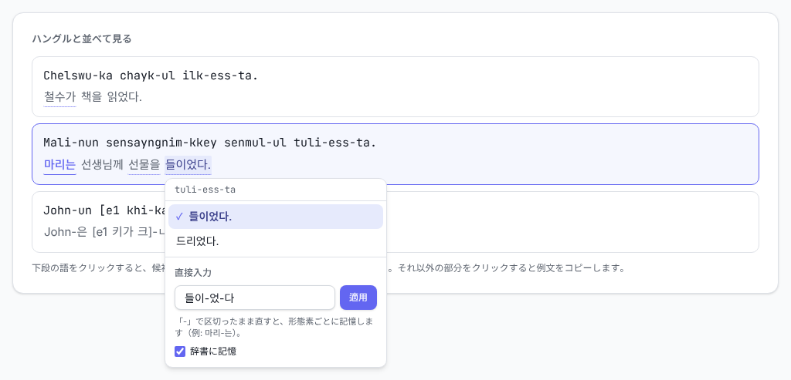
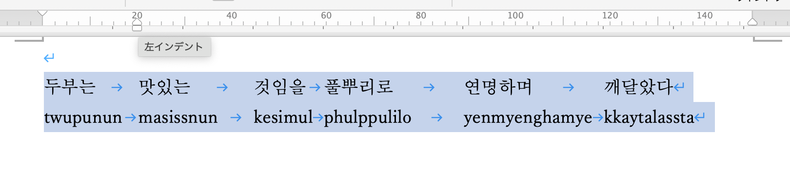
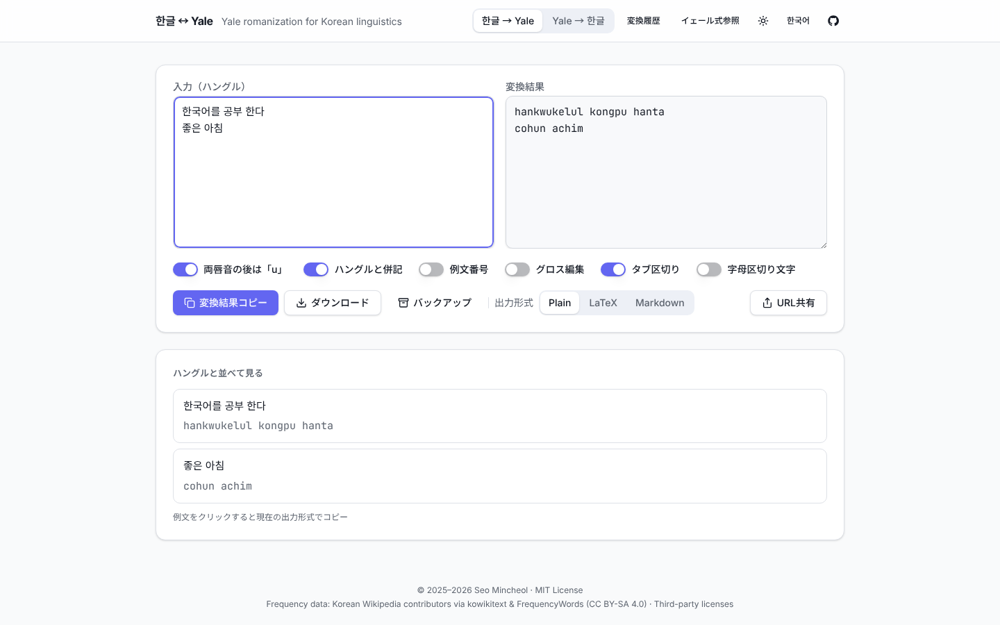

# Hangul ↔ Yale Romanizer
<p align="center">
  
</p>

## 概要

ハングルとイェール式ローマ字(Yale Romanization)を相互に変換します。

主な機能:
- 入力したハングルをイェール式ローマ字に自動変換
- イェール式ローマ字からハングルへの逆変換（ビームサーチDPによる確率的変換）
- 「ハングルと並べて見る」で語をクリックして候補を切り替えたり、直接修正したりできる（`mek-ess-ta` のようなハイフン付きの語も対象）
- 修正は置き換え規則としてユーザー辞書に記憶され、次の変換から自動で使われる（保存前に規則と適用範囲を確認・選択。著者ごとに異なる表記にも対応できる）
- 形態素表記に対応（`-ko` → `-고`、`-(u)n` → `-(으)ㄴ`）。原文の語中の「-」を出力に残すオプションあり
- 英語の名前（`John-un` → `John-은`）や略語（`IP`、`NOM`）はそのまま残す
- 原文（ハングル）とローマ字を上下に並べて表示
- グロス編集: 語ごとに形態素注釈を入力し、Leipzig形式の3行グロス（原文／ローマ字／注釈）を作成
- 3種類の出力形式（Plain / LaTeX / Markdown）と例文番号付与
- ファイルのドラッグ＆ドロップ／結果のダウンロード／URL共有／全状態のバックアップ
- 変換方向を切り替えても入力は消えない（方向ごとに保持）
- 変換履歴を`localStorage`に最大50件まで保存（変換方向も記録、検索・タグ付け対応）
- 字母区切り文字を挿入可能
- ハングル字母とそれに対応するイェール式表記を参照可能
- コピー時のタブ区切り／半角空白の切り替え（Wordでのグロス作成用）
- ダークモード／UI言語切り替え（日本語・韓国語）

---

## 使い方
- インターネットに接続可能な環境では[ウェブアプリケーション](https://hangul-yale-romanizer.netlify.app/)に接続

- ローカルで動かす場合はリポジトリをクローンし、開発サーバーを起動してください（Node 22.18 以降）:
  ```bash
  npm install
  npm run dev
  ```
  ブラウザで http://localhost:5173 にアクセス。

- 本番ビルド:
  ```bash
  npm run build    # dist/ に出力
  npm run preview  # ビルド結果の確認
  ```

---

## 開発

### 技術スタック

- **UI**: React 19 + TypeScript + Tailwind CSS v4 + shadcn/ui（Vite ビルド）
- **変換エンジン**: 依存パッケージなしの純粋な ES Modules（`src/converter/`）— UIフレームワークに依存せず、単体でテスト可能

### テスト

変換ロジック・出力パイプライン・ユーザー辞書・履歴・共有URLの単体テストを Node 標準の test runner で実行できます（TypeScript のモジュールは Node の型除去機能で直接読み込むため Node 22.18 以降が必要）。`tests/y2h-examples.test.js` は自作の例文（形態素区切りの例文・英語の名前・記号）による Yale→ハングル変換の回帰テストで、頻度データや変換エンジンを変えたときに精度が落ちていないかを確認できます。

```bash
npm test
# または
node --test tests/
```

### 型チェック

```bash
npm run typecheck
```

---

## グロス編集

「グロス編集」スイッチをONにすると、「ハングルと並べて見る」の各語の下に注釈欄が表示され、形態素グロスを直接入力できます。入力したグロスは [Leipzig Glossing Rules](https://www.eva.mpg.de/lingua/resources/glossing-rules.php) 形式の3行グロス（原文／ローマ字／注釈）として全出力形式に反映されます:

- **Plain**: 原文／ローマ字／注釈の3行ブロックで出力（「タブ区切り」ONなら語間がタブに置換され、そのままWord等に貼り付け可能）
- **LaTeX**: `\gll` の代わりに `\glll` を使用（未入力の語は `{}`）
- **Markdown**: 表に注釈行を追加

グロスが未入力の場合、出力は従来と完全に同一です。グロスは行のテキストに紐付くため、該当行を編集すると注釈はリセットされます（他の行は保持）。URL共有・バックアップにも含まれます。

---

## Yale → ハングル変換について

### 曖昧性の問題

イェール式ローマ字は、一つのローマ字列が複数のハングル音節列に対応する場合があります。例えば `cenel` は「저널」にも「전얼」にも解釈できます。この曖昧性を解消するため、本ツールでは統計的手法を用いています。

### 変換アルゴリズム

1. 入力されたYale文字列を `.` や `-` で区切り、各セグメントに対して可能な音節分割をすべて列挙します（DAGグラフの構築）。区切った位置では必ず音節が分かれます。
2. **ビームサーチDP**（ビーム幅 K=5）により、以下のスコアを組み合わせて最適な音節列を選択します:
   - **ユニグラムスコア**: 各音節の出現頻度
   - **バイグラムスコア**: 隣接する音節ペアの共起頻度
   - **単語ボーナス**: 頻度データの単語リストにある2〜3音節の並びに対する追加スコア

### 精度と限界

ハングル → Yale → ハングルの往復で測った語単位の正答率は、文語 97.4%・口語 95.5%・ウィキペディア 96.9% です（測定方法は [data/README.md](data/README.md)）。形態素ごとにハイフンで区切った言語学の例文では、区切りの中が短いため、ほぼ正しく変換されます。

変換精度はコーパスのカバレッジに依存します。以下のような場合、誤変換が生じる可能性があります:

- コーパスに含まれない低頻度語（例: 専門用語、外来語）
- バイグラム・単語辞書のいずれにも登録されていない語の組み合わせ
- 文献ごとに異なる表記（例: 標準の Yale では `ney`（네）・`khu`（크）と書くところを `ne`・`ku` と書く文献）

誤変換が生じた場合の対処方法は2つあります:

1. **語をクリックして修正** — Yale→ハングル変換時、「ハングルと並べて見る」の下段の語をクリックすると、上位候補（最大5件）と直接入力欄が表示されます。曖昧性のある語には点線下線が付きます。`cenel-ul`（→ 저널을／전얼을）のようにハイフンを含む語も対象です。修正は出力テキストエリア・ダウンロード・URL共有すべてに反映され、ユーザー辞書に置き換え規則として記憶されます（下記）。
2. **音節境界を明示** — `.` で音節を区切ると、その位置で必ず音節が分かれます（例: `ce.nel` → 저널）。すべての音節を区切れば頻度による推定は入りません（ただし両唇音の後の `u` は ㅜ／ㅡ の両方が候補に残ります）。なお、語末の `.` は境界ではなく文末の句読点として扱われ、変換結果にそのまま保持されます。

### 形態素表記（ハイフン）

言語学文献のYale表記によく見られる形態素境界の `-` も扱えます。

| 入力 | 出力（既定） | 「原文の「-」を残す」ON |
|---|---|---|
| `mek-ess-ta` | 먹었다 | 먹-었-다 |
| `ka-ss-ta` | 갔다 | 가-ㅆ-다 |
| `-ko`, `mek-`, `-ess-` | -고, 먹-, -었- | （同左） |
| `-(u)n`, `-(u)l kes` | -(으)ㄴ, -(으)ㄹ 것 | （同左） |
| `sa-nta`, `ka-lkka` | 산다, 갈까 | 사-ㄴ다, 가-ㄹ까 |

- 既定では、語中の `-` は取り除いてそのまま読めるハングルにします（`-` で区切られた各部分の中は確率変換なので、曖昧な語は候補から選べます）。
- 語頭・語末の `-` は引用形の印として残します。
- 子音だけの形態素は、括弧やハイフンに隣接するときに字母（ㄴ・ㄹ・ㅆ など）で表示します。`NP` や `pp.` のような略語は変換しません。
- 子音で始まる語尾の表記（`-nta`、`-lkka`、`-psita` など）は、その子音を前の音節のパッチムとして扱います。

### 英語の名前・記号

- Yale で使わない文字（b, d, f, g〔ng を除く〕, j, q, r, v, x, z）を含む部分は英語などとみなし、そのまま残します（`John-un` → `John-은`、`Mary-ka` → `Mary-가`）。すべて大文字の略語（`IP`、`NOM` など）も同様です。
- 生成文法・形式意味論の空範疇 `e₁` は、PDF からコピーすると `e1` になります。数字が直後に付いた単独の `e` は変換せず（`[e1` → `[e1`）、ハイフンの後の子音形態素に付いた数字は指標として扱います（`ku]-n1` → `그]-ㄴ1`）。

### ユーザー辞書

語の修正は、置き換え規則としてブラウザ内（`localStorage`）のユーザー辞書に記憶され、次の変換から自動で使われます。辞書の規則が使われた語には実線の下線が付きます。

このツールは形態素解析をしていません。規則は Yale の原文と文字どおりに照合し、範囲は次の2つです。

| 範囲 | 置き換える条件 | 例 |
|---|---|---|
| 区切り一致 | 「-」（または「.」）で区切られた部分が同じなら、長い表記の中でも | `mali` → `마리`（`Mali-nun`・`Mali-ka` の両方） |
| 全体一致 | 表記がちょうど同じときだけ（前後の記号は無視）。長い表記の一部は置き換えない | `ki-ka` → `키-가`（`ki-ka.`・`(ki-ka)` にも適用。`ki-lul`（기를）の `ki` はそのまま）※ |

※ `ki-ka` は、`khi`（키）を `ki` と綴る文献の表記の例です。標準の Yale では `ki-ka` は「기가」です。

<p align="center">
  
</p>

1. 「ハングルと並べて見る」の下段の語をクリックし、候補を選ぶか、直接入力欄を直します。候補を選ぶと入力欄に入ります。
2. その下の「記憶する規則」に、保存される規則が表示されます。範囲は「区切り一致」「全体一致」から選べます。
3. 「適用」（または Enter）で保存します。候補をダブルクリックすると、その候補をすぐ適用します。

- **範囲の既定値** — 変えた部分がすべて2音節以上か、英語の名前など変換されなかった部分なら「区切り一致」、1音節の部分を含むなら「全体一致」です。1音節の部分は、標準の Yale の別の綴りと重なりやすいためです（例: `khi`（키）を `ki` と書く文献の `ki` を区切り一致にすると、標準の Yale の `ki`（기）まで置き換わります）。
- **入力欄の書き方** — 「-」で区切っても区切らなくても構いません。標準の Yale なら、区切らずに入力しても自動で区切りに合わせます（`aphu-n` に「아픈」と入力 → `aphu` → `아프`）。
- **全体一致だけになる場合** — 子音だけの部分を変えたとき、区切りに対応づけられない入力（文献独自の綴りを区切らずに入力したときなど）は、全体一致だけ選べます。
- 「辞書に記憶」のチェックを外して適用すると、そのセッションだけに適用されます。
- ヘッダーの「辞書」ボタン（Yale→ハングルのときに表示。スマートフォンでは本のアイコン）から、規則の確認・検索・追加・削除、JSON ファイルへの書き出し・読み込み（別のブラウザや PC への移行用）ができます。
- 修正を元に戻すには、語をクリックして「使われている辞書の項目」の × を押すか、元の候補を選んで適用します。

---

## 出力形式

論文・ドキュメントへの貼り付けを想定した3種類の出力形式に対応しています。出力形式は変換結果コピーボタンの右側のチップで切り替え可能です（選択は次回起動時にも保持）。

### Plain
素のテキスト出力。入力の改行・空行・空白はそのまま保たれます（候補を選んだ後も同じ）。「タブ区切り」スイッチ（デフォルト ON）が ON のとき、コピー時に半角空白がタブに置換されます（Wordでのグロス作成用）。「例文番号」スイッチをONにすると、内容のある各行の先頭に `(1) (2) (3)…` が付きます。原文と並べた出力が必要な場合は「グロス編集」をONにしてください。

### LaTeX (`gb4e` 形式)
言語学論文で標準的に使われる `gb4e` パッケージの構文で出力します。`\trans` 行は空欄なので訳文を後から挿入してください。

```latex
\begin{exe}
\ex
\gll 한국어를 공부 한다 \\
     hankwukelul kongpu hanta \\
\trans `'
\end{exe}
```

### Markdown 表
GitHub・Notion・Obsidian にそのまま貼り付け可能な表形式。例文ごとに表を分割します（語数が異なる例文を1つの表に合わせるとカラム数が合わないため）。

```markdown
| 한국어를 | 공부 | 한다 |
|---|---|---|
| hankwukelul | kongpu | hanta |
```

---

## ファイル入出力・URL共有

### ファイルのドラッグ＆ドロップ
入力欄に `.txt` / `.csv` / `.tsv` / `.md` などのテキストファイルをドラッグ＆ドロップすると、内容が自動的に読み込まれます（5MB制限。画像などテキスト以外のファイルは読み込みません）。コーパスや例文集など大量テキストの一括変換に便利です。

3万字を超える入力はバックグラウンド（Web Worker）で変換するため、変換中も画面は操作できます（変換結果のラベルに「変換中…」と表示）。「ハングルと並べて見る」は先頭100行まで表示し、「すべて表示」で残りも表示できます。なお、1MBを超えるようなテキストは入力欄・結果欄の描画そのものが重くなるため（ブラウザの仕様）、ドロップ後はそのままダウンロードする使い方をおすすめします。

### 結果のダウンロード
「ダウンロード」ボタンで現在の出力をファイルとして保存できます。出力形式に応じて拡張子・MIMEタイプが自動的に決まります:

| 出力形式 | 拡張子 | MIME |
|---|---|---|
| Plain    | `.txt` | `text/plain` |
| LaTeX    | `.tex` | `application/x-tex` |
| Markdown | `.md`  | `text/markdown` |

ファイル名は `yale-{方向}-{タイムスタンプ}.{拡張子}` 形式で生成されます（例: `yale-h2y-2026-05-02T09-30-00.tex`）。

### URL共有
「URL共有」ボタンを押すと、現在の入力テキスト・全オプション（変換方向・両唇音・区切り文字・原文の「-」の保持・併記・出力形式・例文番号）・入力の変換に使われたユーザー辞書の規則・グロス注釈をURLにエンコードしてクリップボードにコピーします（受け取った側では、その規則はそのセッションだけに適用されます）。共同研究者にこのURLを送れば、同じ画面が再現されます。旧バージョンで生成した共有URLもそのまま開けます。

URLパラメータがある場合は、ブラウザの`localStorage`設定よりも優先して適用されます。

### バックアップ
「バックアップ」ボタンで、入力・出力・全オプション・入力に使われたユーザー辞書の規則・グロス注釈をひとつのJSONファイルにまとめて保存できます（ユーザー辞書の「読み込み」でこのファイルの規則を取り込むこともできます）。ファイル内の `shareUrl` をブラウザで開けば、保存時の画面をそのまま再現できます。

---

## 履歴

変換結果は自動的に`localStorage`に保存されます（最大50件）。

- 入力中の途中経過は1件にまとめて記録し、コピー・ダウンロード・共有・方向の切り替えなどで結果を使った時点で確定します（その後の編集は新しい項目になります）
- 変換方向も記録し、「復元」すると方向も自動で切り替わります
- 5万字を超える入力は記録しません（ブラウザの保存容量を守るため）

「変換履歴」ドロワーから:

- **検索** — 入力ボックスに文字列を入れると、該当する履歴のみフィルタリング
- **タグ** — 各項目に任意のタグを付けて分類。タグ一覧から絞り込み可能
- **ピン留め** — よく使う履歴を上部に固定
- **すべて削除** — 誤操作防止のため、もう一度押すと削除されます

---

## コピー機能
- 「タブ区切り」スイッチ（デフォルト ON）が ON のとき、Plain 形式のコピーは半角空白を「タブ」に置換します。OFF にすると半角空白のまま コピーされます（設定は次回起動時にも保持）。
- この設定は3つのコピー経路すべてに適用されます: 「変換結果コピー」ボタン／「変換結果」内のテキスト選択（自動コピー）／「ハングルと並べて見る」の例文クリック（Yale→ハングルでは下段の語をクリックすると修正欄が開くので、上段や余白をクリックします）。
- LaTeX・Markdown 形式はそれぞれの構文を壊さないよう、常にそのままコピーされます。

「半角空白」の代わりに「タブ」を挿入している理由は、Wordなどで[グロス](https://ja.wikipedia.org/wiki/%E3%82%B0%E3%83%AD%E3%82%B9_(%E8%A8%80%E8%AA%9E%E5%AD%A6))を付けるときに、複数行の調整が便利だからです。

<p align="center">
  
</p>

---

## スクリーンショット
<p align="center">
  
</p>

---

## データソース

Yale→ハングル変換の頻度データ (`data/syllable-freq.json`) は、文語と口語の 2 つのコーパスを等しい重みで混ぜて生成しています:

- **韓国語版ウィキペディア** — [lovit / kowikitext](https://github.com/lovit/kowikitext)（2020-09-20 のダンプから作成）
  - ライセンス: [CC BY-SA 3.0](https://creativecommons.org/licenses/by-sa/3.0/)（© ウィキペディアの執筆者）
- **[Hermit Dave / FrequencyWords](https://github.com/hermitdave/FrequencyWords)** by Hermit Dave — 字幕コーパスの単語頻度 `ko_full.txt`
  - コンテンツライセンス: [CC BY-SA 4.0](https://creativecommons.org/licenses/by-sa/4.0/)
  - データソース: [OpenSubtitles](https://www.opensubtitles.org/) 2018 Korean corpus

頻度データには、ユニグラム（音節頻度）、バイグラム（音節ペア頻度）、および単語頻度（2〜3音節）が含まれています。生成手順は [`scripts/gen_syllable_freq.py`](scripts/gen_syllable_freq.py)、頻度データは CC BY-SA 4.0 で提供しています（詳細は [data/README.md](data/README.md)）。

---

## 参考プロジェクト

このプロジェクトは、MIT licenseで公開されている以下のプロジェクトを参考にしています:

- **[asaokitan / hangul2yale](https://github.com/asaokitan/hangul2yale)** by 淺尾 仁彦
- **[stannam / hangul_to_ipa](https://github.com/stannam/hangul_to_ipa)** by Stanley Nam

---

## ライセンス

- **ソースコード**: [MIT License](LICENSE)
- **頻度データ** `data/syllable-freq.json`: [CC BY-SA 4.0](https://creativecommons.org/licenses/by-sa/4.0/)（[data/README.md](data/README.md)）
- **同梱ライブラリ**: 各パッケージのライセンスに従います。ビルド時に `third-party-licenses.txt` を生成してアプリと一緒に配信します

詳細は [NOTICE.md](NOTICE.md) を参照してください。
